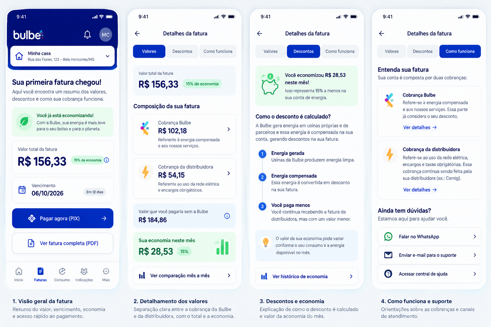
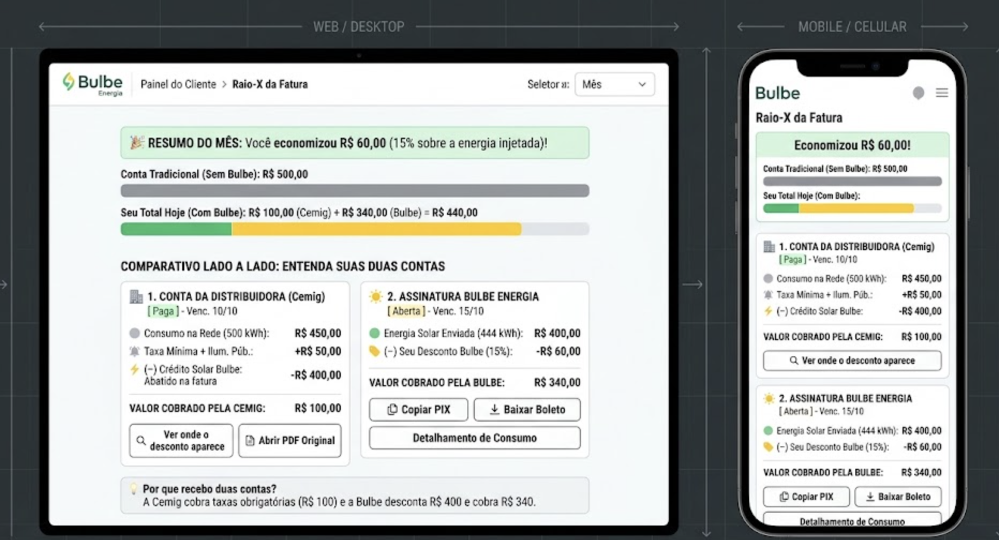
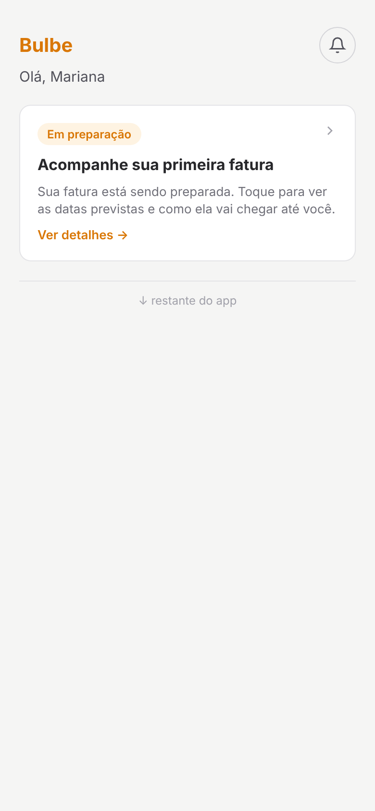
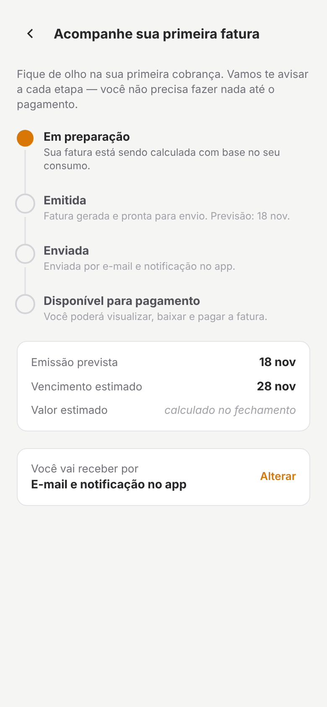
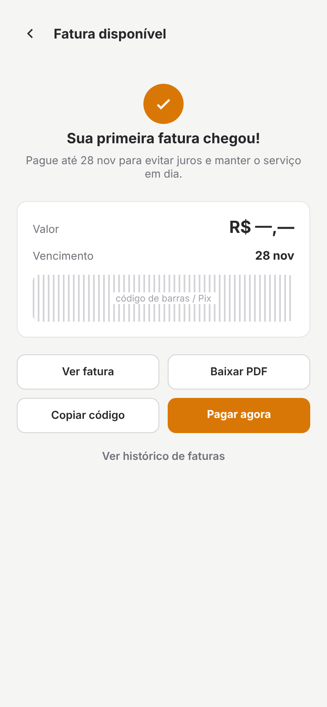
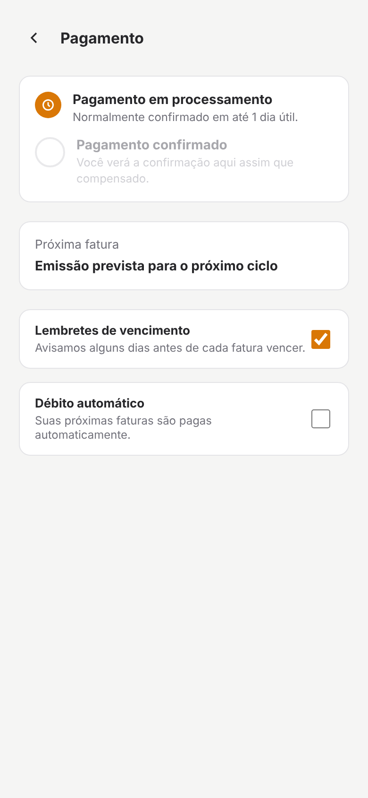

# Wireframes

Guardem aqui as imagens exportadas dos wireframes (PNG ou JPG), uma por tela, e também a imagem do mapa de jornada (`jornada.png`).

Nomeie os arquivos de tela com o ID da história: `hu01-confirmar-contatos.png`.

## HU01 — Entender a primeira fatura

**Responsável:** João Vitor Oliveira

**História:** [HU01 — Issue #7](https://github.com/joaoezrx/202602-projeto1-b-02/issues/7)

### Proposta de melhoria

A Bulbe já possui uma tela de detalhamento da fatura.
A proposta da HU01 busca melhorar essa experiência,
organizando as informações para facilitar a compreensão
da primeira cobrança.

O protótipo foi dividido em quatro partes:

1. Visão geral da primeira fatura, com valor e vencimento.
2. Detalhamento das cobranças da Bulbe e da distribuidora.
3. Explicação dos descontos e da economia.
4. Orientações sobre a cobrança e canais de suporte.

O objetivo é facilitar o entendimento da primeira fatura
e dar mais segurança ao cliente antes do pagamento.

**Observação:** os valores apresentados são ilustrativos.
A proposta ainda depende de validação das regras de cobrança.

### Protótipo visual

## HU02 — Comparativo das faturas (Raio-X da Fatura)

**Responsável:** Gabriel Moura Muniz

**História:** [HU02 — Issue #12](https://github.com/joaoezrx/202602-projeto1-b-02/issues/12)

**Oportunidade de origem:** [Issue #8](https://github.com/joaoezrx/202602-projeto1-b-02/issues/8)

### Proposta de melhoria

A proposta apresenta um comparativo visual entre a conta
da distribuidora (Cemig) e a cobrança da Bulbe Energia,
facilitando o entendimento dos créditos solares, descontos
e valores cobrados.

O wireframe contempla versões desktop e mobile, com cartões
que apresentam as informações de cada cobrança e um resumo
da economia obtida.

O objetivo é reduzir dúvidas sobre a existência de duas
faturas e explicar a relação entre a energia compensada
e os valores pagos.

**Observação:** os valores são ilustrativos e dependem
de validação das regras de faturamento da Bulbe.

### Wireframe visual

## HU03 — Acompanhar a primeira fatura

**Responsável:** Felipe Rodrigues Pratti

**História:** [HU03 — Issue #9](https://github.com/joaoezrx/202602-projeto1-b-02/issues/9)

**Oportunidade de origem:** [Issue #6](https://github.com/joaoezrx/202602-projeto1-b-02/issues/6)

### Proposta de melhoria

A proposta permite que o cliente acompanhe o andamento da sua primeira fatura desde a preparação até a disponibilização para pagamento.

O fluxo apresenta quatro telas:

1. Aviso na tela inicial sobre a preparação da primeira fatura.
2. Linha do tempo com etapas da cobrança, datas previstas e canal de recebimento.
3. Tela de fatura disponível, com acesso ao documento e opções de pagamento.
4. Acompanhamento do processamento do pagamento e opções de lembretes.

O objetivo é reduzir a incerteza sobre quando a primeira cobrança estará disponível e orientar o cliente durante o processo.

**Observação:** datas, valores e funcionalidades de pagamento são ilustrativos e dependem de validação com a Bulbe.

### Wireframes visuais

