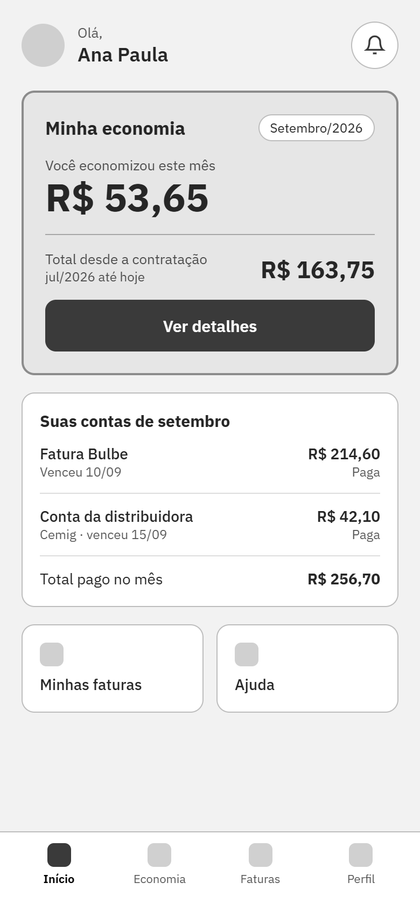
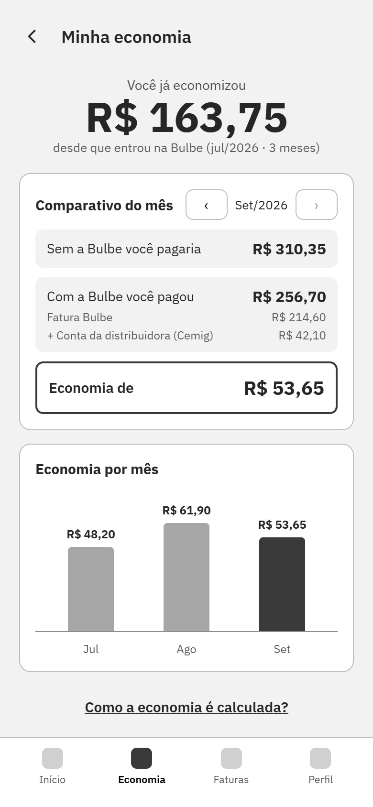
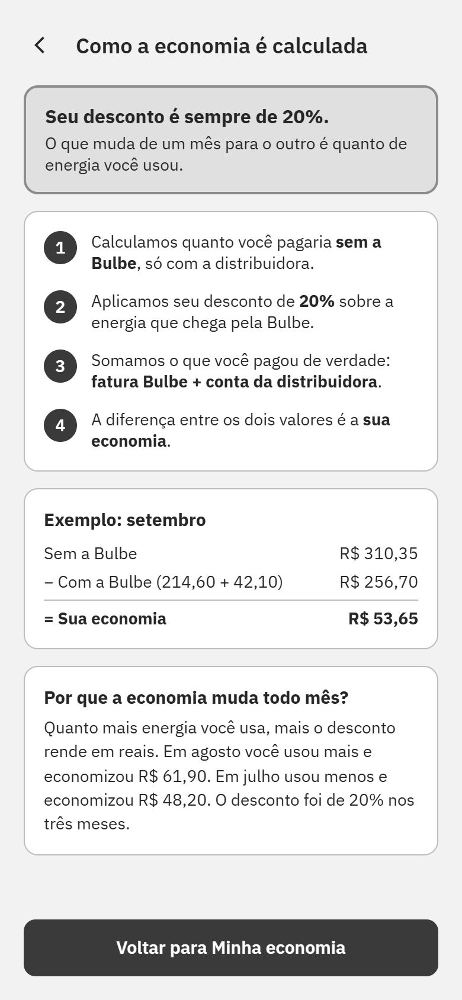
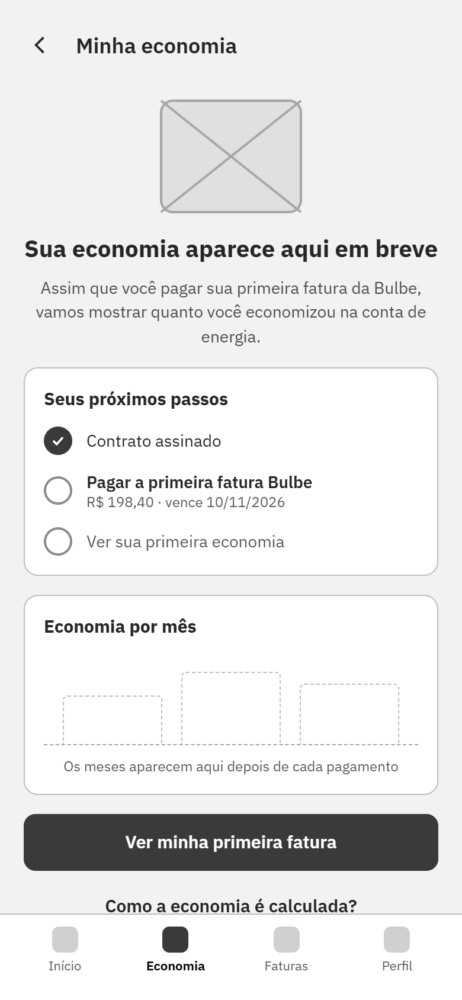

# Wireframes

Guardem aqui as imagens exportadas dos wireframes (PNG ou JPG), uma por tela, e também a imagem do mapa de jornada (`jornada.png`).

Nomeie os arquivos de tela com o ID da história: `hu01-confirmar-contatos.png`.

## HU01 — Entender a primeira fatura

**Responsável:** João Vitor Oliveira

**História:** [HU01 — Issue #7](https://github.com/joaoezrx/202602-projeto1-b-02/issues/7)

**Oportunidade de origem:** [Issue #5](https://github.com/joaoezrx/202602-projeto1-b-02/issues/5)

### Problema identificado

O cliente pode receber sua primeira fatura sem compreender a composição dos valores, os descontos aplicados e a diferença entre as cobranças da Bulbe e da distribuidora.

**Fonte:** Apresentação da Bulbe ao Ibmec — setembro/2026.

### Proposta de melhoria

A proposta busca facilitar o entendimento da primeira fatura por meio de uma interface mais clara, organizada e com informações apresentadas progressivamente.

O fluxo apresenta três telas:

1. **Resumo da fatura:** apresenta o valor total, o desconto obtido, o consumo e os principais componentes da cobrança.
2. **Detalhamento do cálculo:** demonstra como o valor final da fatura é formado, destacando consumo, desconto e taxas.
3. **Perguntas e respostas:** reúne as principais dúvidas sobre descontos, cobranças da distribuidora, impostos e pagamento.

O objetivo é reduzir dúvidas e inseguranças antes do pagamento, permitindo que o cliente compreenda o que está sendo cobrado e quanto economizou.

A HU01 foi escolhida como foco do MVP da Sprint II.

**Observação:** os valores, descontos e demais informações apresentados nos wireframes são ilustrativos e dependem de validação com a Bulbe.

### Wireframes visuais

| 1. Resumo da fatura | 2. Detalhamento do cálculo | 3. Perguntas e respostas |
|---|---|---|
|  |  |  |

## HU02 — Comparativo das faturas (Raio-X da Fatura)

**Responsável:** Gabriel Moura Muniz

**História:** [HU02 — Issue #12](https://github.com/joaoezrx/202602-projeto1-b-02/issues/12)

**Oportunidade de origem:** [Issue #8](https://github.com/joaoezrx/202602-projeto1-b-02/issues/8)

### Proposta de melhoria

A proposta apresenta um comparativo visual entre a conta
da distribuidora (Cemig) e a cobrança da Bulbe Energia,
facilitando o entendimento dos créditos solares, descontos
e valores cobrados.

O wireframe contempla versões desktop e mobile, com cartões
que apresentam as informações de cada cobrança e um resumo
da economia obtida.

O objetivo é reduzir dúvidas sobre a existência de duas
faturas e explicar a relação entre a energia compensada
e os valores pagos.

**Observação:** os valores são ilustrativos e dependem
de validação das regras de faturamento da Bulbe.

### Wireframe visual

## HU03 — Acompanhar a primeira fatura

**Responsável:** Felipe Rodrigues Pratti

**História:** [HU03 — Issue #9](https://github.com/joaoezrx/202602-projeto1-b-02/issues/9)

**Oportunidade de origem:** [Issue #6](https://github.com/joaoezrx/202602-projeto1-b-02/issues/6)

### Proposta de melhoria

A proposta permite que o cliente acompanhe o andamento da sua primeira fatura desde a preparação até a disponibilização para pagamento.

O fluxo apresenta quatro telas:

1. Aviso na tela inicial sobre a preparação da primeira fatura.
2. Linha do tempo com etapas da cobrança, datas previstas e canal de recebimento.
3. Tela de fatura disponível, com acesso ao documento e opções de pagamento.
4. Acompanhamento do processamento do pagamento e opções de lembretes.

O objetivo é reduzir a incerteza sobre quando a primeira cobrança estará disponível e orientar o cliente durante o processo.

**Observação:** datas, valores e funcionalidades de pagamento são ilustrativos e dependem de validação com a Bulbe.

### Wireframes visuais

| 1. Tela inicial | 2. Acompanhamento | 3. Fatura disponível | 4. Pagamento |
|---|---|---|---|
|  |  |  |  |

## HU04 — Visualizar economia acumulada

**Responsável:** Enrico Pesso Cota

**História:** [HU04 — Issue #14](https://github.com/joaoezrx/202602-projeto1-b-02/issues/14)

**Oportunidade de origem:** [Issue #13](https://github.com/joaoezrx/202602-projeto1-b-02/issues/13)

### Proposta de melhoria

A proposta facilita a visualização da economia mensal
e acumulada do cliente Bulbe, apresentando comparativos
com os custos estimados sem o serviço.

O fluxo apresenta quatro telas:

1. Tela inicial com resumo da economia e das faturas do mês.
2. Detalhamento da economia acumulada, comparativo e gráfico histórico.
3. Explicação do cálculo da economia, com exemplo ilustrativo.
4. Estado inicial para clientes sem fatura paga, com próximos passos.

O objetivo é tornar o benefício financeiro mais compreensível
e visível ao longo do relacionamento com a Bulbe.

**Observação:** valores, percentual de desconto e regras de
cálculo são ilustrativos e dependem de validação com a Bulbe.

### Wireframes visuais

| 1. Tela inicial | 2. Minha economia | 3. Como a economia é calculada |
|---|---|---|
|  |  |  |

### Fluxo alternativo — Cliente sem faturas pagas

